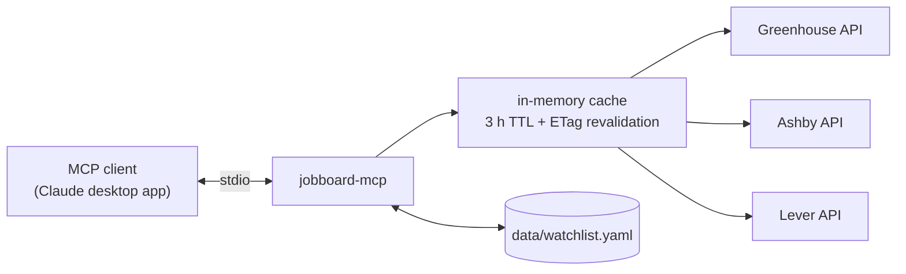

# jobboard-mcp

[](https://github.com/HakujouRyu/jobboard-mcp/actions/workflows/pr-checks.yml)
[](pyproject.toml)
[](LICENSE)

A small [MCP](https://modelcontextprotocol.io) server that sweeps public applicant-tracking-system
job boards (**Greenhouse, Ashby, Lever**) for a watchlist of companies and returns clean,
normalized, filtered jobs.

One `sweep_boards` call fetches every watched board in parallel and returns only the matching
jobs. Pay, posting date, and remote status are parsed by code, with the raw values kept for
checking. It replaces asking an assistant to fetch each careers page one at a time, which
truncates big boards and parses those fields differently every run.



**What it doesn't do:** it never scrapes LinkedIn, Indeed, or job content from web pages. The
one exception to "JSON APIs only" is `resolve_board`, which reads a company's careers page (and
at most two same-site careers links from it) only to find which board it links to. It needs no
accounts or credentials, and the only file it writes is its own watchlist.

## Tools

| Tool | What it does |
|------|--------------|
| `sweep_boards` | Fetches every watched board in parallel, applies title / remote / pay / date / seen-before filters, and returns matching jobs newest first, with a status per company (`ok`, `not_found`, `no_board`, `error`, `timeout`). |
| `get_posting` | One posting by URL or `{ats, token, job_id}`, with its full plain-text description and the best pay data (Greenhouse pay-transparency ranges included). |
| `find_company_posting` | Finds a role seen on LinkedIn, Indeed, etc. on the company's own board (the watchlist board, or one resolved on the fly). Returns up to 5 fuzzy-matched candidates scored 0-100. |
| `resolve_board` | Works out which Greenhouse, Ashby, or Lever board a company uses, by probing likely tokens and scanning the careers page for board links. Read-only. |
| `is_posting_live` | Whether a posting is still open, checked through the ATS API. |
| `list_watchlist` | Watched companies, filterable by board / tag / domain. Archived companies are hidden unless asked for. |
| `add_company`, `update_company` | The only writes, and only to `data/watchlist.yaml`. Boards are validated with a live fetch before saving, and comments and formatting are kept. To drop a company, archive it with `update_company`; sweeps then skip it. Not registered when `WATCHLIST_READONLY=true`. |

Full parameters and example outputs are in **[docs/tools.md](docs/tools.md)**.

### Example

Calling `sweep_boards` with:

```json
{ "title_include": ["engineer", "sre"], "min_pay": 100000, "posted_within_days": 21 }
```

returns this (abridged):

```json
{
  "jobs": [
    {
      "id": "greenhouse:gitlab:8710061002",
      "company": "GitLab",
      "title": "Migration Engineer - GitLab Dedicated",
      "locations": ["Remote, United States"],
      "remote": "remote_us",
      "posted_at": "2026-08-19",
      "pay_min": 126400,
      "pay_max": 213600,
      "pay_raw": "$126,400–$213,600 USD",
      "pay_source": "parsed_from_text",
      "url": "https://job-boards.greenhouse.io/gitlab/jobs/8710061002",
      "flags": []
    }
  ],
  "per_company": [
    { "company": "GitLab", "ats": "greenhouse", "total": 218, "matched": 6, "status": "ok" }
  ],
  "cache_hits": 0,
  "flag_counts": { "pay_unknown": 3, "remote_unknown": 2 }
}
```

### Normalization in brief

- **Remote:** `remote_us` needs positive evidence that a US-based worker is eligible. A bare
  "Remote" is `unknown`, and so is "United States" with no remote signal. Locations that name
  only non-US countries or regions ("Portugal", "ANZ Region") are `remote_other`. Unknown jobs
  are kept and flagged `remote_unknown` (pass `include_unknown_remote: false` to drop them).
- **Pay:** structured fields first, then ranges parsed from the description. `pay_min` /
  `pay_max` are annual USD only (hourly × 2080), and `pay_posted_interval` says how the pay was
  posted. Non-USD pay keeps its currency and raw text but has no numbers. Multi-tier pay reports
  the overall range.
- **Employment type:** from the ATS field, or `contract` when the title says so ("(Contract)",
  "Contract Software Engineer").
- **Titles:** plain filter terms match whole words plus a plural, so the default `intern`
  exclude keeps "Internal Tools Engineer". Prefix a term with `re:` for a regex.
- **Missing data** never silently drops a job. Every job's `flags` say what's missing
  (`pay_unknown`, `pay_not_usd`, `date_unknown`, `remote_unknown`), whatever filters you use.

The full rules, with decision diagrams, are in **[docs/normalization.md](docs/normalization.md)**.

## Quick start

Requires [uv](https://docs.astral.sh/uv/), which installs Python 3.12 for you.

```sh
uv sync
uv run pytest            # offline, against recorded fixtures
uv run jobboard-mcp      # start the server on stdio
```

On first run the server copies [data/watchlist.example.yaml](data/watchlist.example.yaml) to
`data/watchlist.yaml`, which git ignores. Edit that copy to choose which companies to watch (see
[docs/watchlist.md](docs/watchlist.md)), or use `add_company` from your MCP client.

### Use from the Claude desktop app

Add this to `claude_desktop_config.json` and restart the app:

```json
{
  "mcpServers": {
    "jobboard": {
      "command": "uv",
      "args": ["--directory", "/path/to/jobboard-mcp", "run", "jobboard-mcp"]
    }
  }
}
```

If the file already has an `mcpServers` object, add the `"jobboard"` entry inside it. If the app
can't find `uv`, use its full path (`where uv` on Windows, `which uv` elsewhere). On Windows,
escape backslashes in paths (`"A:\\code\\jobboard-mcp"`).

The config file is at:

| Install | Path |
|---------|------|
| macOS | `~/Library/Application Support/Claude/claude_desktop_config.json` |
| Windows | `%APPDATA%\Claude\claude_desktop_config.json` |
| Windows (Microsoft Store) | `%LOCALAPPDATA%\Packages\Claude_pzs8sxrjxfjjc\LocalCache\Roaming\Claude\claude_desktop_config.json` |

## Configuration

Environment variables, all optional:

| Variable | Default | |
|----------|---------|---|
| `WATCHLIST_PATH` | `data/watchlist.yaml` | Only the default path is created from the example on first run |
| `CACHE_TTL_SECONDS` | `10800` (3 h) | Boards are refetched at most once per TTL unless `refresh: true`. Stale entries revalidate with ETag / Last-Modified. |
| `MAX_CONCURRENCY` | `8` | Global cap on requests in flight |
| `PER_HOST_CONCURRENCY` | `4` | Cap per host |
| `HTTP_TIMEOUT_SECONDS` | `15` | 429s and 5xxs are retried twice with backoff, honoring `Retry-After` |
| `LOG_LEVEL` | `INFO` | JSON logs go to stderr (stdout is the MCP transport) |
| `WATCHLIST_READONLY` | `false` | `true` removes `add_company` and `update_company`, for a public deployment |
| `ALLOW_CUSTOM_URLS` | `true` | `false` refuses careers URLs from the client, so careers pages are fetched only from the watchlist. Set it for a public deployment. |

## Documentation

| | |
|---|---|
| [docs/architecture.md](docs/architecture.md) | Components, the sweep sequence, the HTTP client, board resolution, the data model, and design decisions, with diagrams |
| [docs/tools.md](docs/tools.md) | Every tool's parameters and output, with examples |
| [docs/normalization.md](docs/normalization.md) | Remote, pay, date, and filter rules |
| [docs/watchlist.md](docs/watchlist.md) | Watchlist format, finding tokens, how edits are made safely |
| [docs/api-notes.md](docs/api-notes.md) | How the live Greenhouse / Ashby / Lever APIs differ from their docs |
| [SPEC.md](SPEC.md) | Original design spec and milestones |
| [CONTRIBUTING.md](CONTRIBUTING.md) | Setup, ground rules, tests, and how to add an ATS or a tool |
| [CHANGELOG.md](CHANGELOG.md) | What changed in each release |
| [SECURITY.md](SECURITY.md) | How to report a vulnerability, and what's in scope |

## Status

| Milestone | |
|-----------|---|
| M1: adapters, normalization, `sweep_boards`, `get_posting`, stdio | done |
| M2: `find_company_posting`, `resolve_board`, `is_posting_live`, watchlist tools | done |
| M3: streamable HTTP transport, Dockerfile, hosted deploy | not started (`--http` exits with a message) |
| M4: SEC business-address lookup, OpenTelemetry, more ATS adapters | optional |

## Development

```sh
uv run pytest                        # offline, against recorded fixtures
uv run pytest -m live                # opt-in: hits the real board APIs
uv run ruff check . && uv run pyright
```

See [CONTRIBUTING.md](CONTRIBUTING.md). Everyone taking part is expected to follow the
[code of conduct](CODE_OF_CONDUCT.md).

## License

MIT
