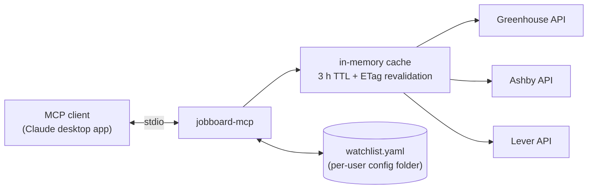

# jobboard-mcp

[](https://github.com/HakujouRyu/jobboard-mcp/actions/workflows/ci.yml?query=branch%3Amain)
[](pyproject.toml)
[](LICENSE)

A small [MCP](https://modelcontextprotocol.io) server that reads the public job boards of the
companies on your watchlist and returns their jobs normalized and filtered. It supports boards
hosted on four applicant tracking systems (ATSes): **Greenhouse, Ashby, Lever, and Workday**.



## Goals

- **Data from the source.** Jobs come from each company's own board, through the public JSON
  API its ATS publishes for job listings.
- **The same answer every time.** Pay, posting date, and remote status are parsed by code with
  fixed rules, so a posting gives the same result on every call. The raw values are returned
  too, for checking.
- **No guessing.** When a posting doesn't settle a question, the answer is `unknown` and the job
  is flagged. Missing data never drops a job without saying so.
- **Safe to run.** It only reads: its requests are GETs, plus the read-only job searches
  Workday's careers sites make themselves. It needs no accounts or credentials, and the only
  file it writes is its own watchlist.

## What it does

- **Sweeps the watchlist.** One `sweep_boards` call fetches every watched board in parallel and
  returns the jobs that pass the title, remote, pay, and date filters the call sets.
- **Reads one posting** in full, with its plain-text description and the most detailed pay data
  the ATS provides.
- **Checks whether a posting is still open.**
- **Finds a role seen elsewhere**, such as on LinkedIn or Indeed, on the company's own board.
- **Works out which board a company uses**, from its name, its careers page, and a bundled
  list of 4,168 known Greenhouse boards.
- **Manages the watchlist.** It adds, updates, and archives companies. A new board is checked
  with a live fetch before it's saved, and the file's comments and formatting are kept.

Only sweeps are limited to the watchlist. The other tools work for any company whose board is on
a supported ATS.

## Limitations

- **It finds new jobs only at watched companies.** It doesn't search sites that list jobs from
  many employers, and it can't suggest companies to watch.
- **Four ATSes.** Only boards on Greenhouse, Ashby, Lever, and Workday can be swept. Workday has
  no documented API, so it's read from the JSON its careers sites load for themselves
  (`source: "careers_site"`). That data can change without notice, and Workday sweeps are slower:
  searches for your title terms, then up to 20 detail calls per board, a second apart. A
  company that uses
  another system, or lists jobs only on its own site, can stay on the watchlist with its careers
  URL, but sweeps skip it with the status `no_board`.
- **No scraping.** It doesn't read job content from web pages. The only pages it reads are a
  company's careers page and at most two same-site careers links from it, in `resolve_board`,
  only to find which board they link to, and only where the site's robots.txt allows.
- **US-focused.** `remote_us` is the only remote status tied to one country. A remote role
  elsewhere is `remote_global` or `remote_other`, which don't say which countries qualify. Pay
  works in any currency and is never converted, but hourly pay is annualized at the US figure of
  2080 hours a year.
- **No history.** Boards are cached in memory for 3 hours, and nothing is kept across restarts.
  To leave out jobs already seen, the client passes their ids, URLs, or fingerprints to
  `sweep_boards`.
- **It doesn't apply for jobs** or track applications.
- **Local only.** It runs over stdio. An HTTP transport for hosted use is planned (M3).

## Tools

| Tool | What it does |
|------|--------------|
| `sweep_boards` | Fetches every watched board in parallel, applies title / remote / pay / date / seen-before filters, and returns matching jobs newest first (up to `limit`, 100 by default), with a status per company (`ok`, `not_found`, `no_board`, `error`, `timeout`). |
| `get_posting` | One posting by URL or `{ats, token, job_id}`, with its full plain-text description and the best pay data (Greenhouse pay-transparency ranges included). |
| `find_company_posting` | Finds a role seen on LinkedIn, Indeed, etc. on the company's own board (the watchlist board, or one resolved on the fly). Matches the company name loosely and reports the watchlist's name. Returns up to 5 fuzzy-matched candidates scored 0-100. |
| `resolve_board` | Works out which Greenhouse, Ashby, Lever, or Workday board a company uses, by probing likely tokens and scanning the careers page for board links. Read-only. |
| `is_posting_live` | Whether a posting is still open, checked through the ATS API. |
| `list_watchlist` | Watched companies, filterable by board / tag / domain. Archived companies are hidden unless asked for. |
| `add_company`, `update_company` | The only writes, and only to the watchlist file. Boards are validated with a live fetch before saving, and comments and formatting are kept. To drop a company, archive it with `update_company`; sweeps then skip it. Not registered when `WATCHLIST_READONLY=true`. |

Full parameters and example outputs are in **[docs/tools.md](docs/tools.md)**.

### Example

Calling `sweep_boards` with:

```json
{ "title_include": ["engineer", "sre"], "min_pay": 100000, "posted_within_days": 21 }
```

returns this (abridged):

```json
{
  "jobs": [
    {
      "id": "greenhouse:gitlab:8710061002",
      "company": "GitLab",
      "title": "Migration Engineer - GitLab Dedicated",
      "locations": ["Remote, United States"],
      "remote": "remote_us",
      "posted_at": "2026-08-19",
      "pay_min": 126400,
      "pay_max": 213600,
      "pay_currency": "USD",
      "pay_raw": "$126,400–$213,600 USD",
      "pay_source": "parsed_from_text",
      "url": "https://job-boards.greenhouse.io/gitlab/jobs/8710061002",
      "flags": [],
      "unverified_filters": []
    }
  ],
  "matched": 6,
  "truncated": false,
  "per_company": [
    { "company": "GitLab", "ats": "greenhouse", "total": 218, "matched": 6, "status": "ok" }
  ],
  "cache_hits": 0,
  "flag_counts": { "pay_unknown": 3, "remote_unknown": 2 },
  "unverified_counts": { "min_pay": 3 }
}
```

### Normalization in brief

- **Remote:** `remote_us` needs positive evidence that a US-based worker is eligible. A bare
  "Remote" is `unknown`, and so is "United States" with no remote signal. Locations that name
  only non-US countries or regions ("Portugal", "ANZ Region") are `remote_other`. Unknown jobs
  are kept and flagged `remote_unknown` (pass `include_unknown_remote: false` to drop them).
- **Pay:** structured fields first, then ranges parsed from the description. `pay_min` /
  `pay_max` are annual amounts (hourly × 2080) in `pay_currency`, the currency the job was posted
  in. Nothing is converted. A posting with several currencies reports USD first when offered,
  and the others in `pay_other_currencies`. `min_pay` takes a `min_pay_currency` (default USD).
  Multi-tier pay reports the overall range.
- **Employment type:** from the ATS field, or `contract` when the title says so ("(Contract)",
  "Contract Software Engineer").
- **Titles:** filter terms match whole words plus a plural, so excluding `intern` keeps
  "Internal Tools Engineer". Terms are plain phrases: a regex-looking term (`re:...`, `a|b`) is
  refused rather than silently matching nothing, and `term_hits` says how many titles each
  term matched.
- **No hidden filters:** every `sweep_boards` filter is off unless the call sets it.
- **Missing data** never silently drops a job. Every job's `flags` say what's missing
  (`pay_unknown`, `date_unknown`, `remote_unknown`), whatever filters you use. When that keeps a
  job a filter couldn't check, such as an unknown date under `posted_within_days` or EUR pay
  under a USD `min_pay`, its `unverified_filters` names the filter.

The full rules, with decision diagrams, are in **[docs/normalization.md](docs/normalization.md)**.

## Quick start

Requires [uv](https://docs.astral.sh/uv/), which installs Python 3.12 for you.

```sh
uv sync
uv run pytest            # offline, against recorded fixtures
uv run jobboard-mcp      # start the server on stdio
```

On first run the server copies the [example watchlist](src/jobboard_mcp/watchlist.example.yaml)
to `%APPDATA%\jobboard-mcp\watchlist.yaml` on Windows, or `~/.config/jobboard-mcp/watchlist.yaml`
elsewhere. Edit that copy to choose which companies to watch (see
[docs/watchlist.md](docs/watchlist.md)), or use `add_company` from your MCP client.

### Use from the Claude desktop app

Add this to `claude_desktop_config.json` and restart the app:

```json
{
  "mcpServers": {
    "jobboard": {
      "command": "uv",
      "args": ["--directory", "/path/to/jobboard-mcp", "run", "jobboard-mcp"]
    }
  }
}
```

If the file already has an `mcpServers` object, add the `"jobboard"` entry inside it. If the app
can't find `uv`, use its full path (`where uv` on Windows, `which uv` elsewhere). On Windows,
escape backslashes in paths (`"A:\\code\\jobboard-mcp"`).

The config file is at:

| Install | Path |
|---------|------|
| macOS | `~/Library/Application Support/Claude/claude_desktop_config.json` |
| Windows | `%APPDATA%\Claude\claude_desktop_config.json` |
| Windows (Microsoft Store) | `%LOCALAPPDATA%\Packages\Claude_pzs8sxrjxfjjc\LocalCache\Roaming\Claude\claude_desktop_config.json` |

## Configuration

Environment variables, all optional:

| Variable | Default | |
|----------|---------|---|
| `WATCHLIST_PATH` | `%APPDATA%\jobboard-mcp\watchlist.yaml` (Windows), `~/.config/jobboard-mcp/watchlist.yaml` (elsewhere; honors `$XDG_CONFIG_HOME`) | Only the default path is created from the example on first run |
| `CACHE_TTL_SECONDS` | `10800` (3 h) | Boards are refetched at most once per TTL unless `refresh: true`. Stale entries revalidate with ETag / Last-Modified. |
| `MAX_CONCURRENCY` | `8` | Global cap on requests in flight |
| `PER_HOST_CONCURRENCY` | `4` | Cap per host |
| `PER_HOST_INTERVAL_SECONDS` | `1` | Minimum gap between requests to one careers site. The job board APIs aren't paced. |
| `HTTP_TIMEOUT_SECONDS` | `15` | 429s and 5xxs are retried twice with backoff, honoring `Retry-After` |
| `LOG_LEVEL` | `INFO` | JSON logs go to stderr (stdout is the MCP transport) |
| `WATCHLIST_READONLY` | `false` | `true` removes `add_company` and `update_company`, for a public deployment |
| `ALLOW_CUSTOM_URLS` | `true` | `false` refuses careers URLs from the client, so careers pages are fetched only from the watchlist. Set it for a public deployment. |

## Documentation

| | |
|---|---|
| [docs/architecture.md](docs/architecture.md) | Components, the sweep sequence, the HTTP client, board resolution, the data model, and design decisions, with diagrams |
| [docs/tools.md](docs/tools.md) | Every tool's parameters and output, with examples |
| [docs/normalization.md](docs/normalization.md) | Remote, pay, date, and filter rules |
| [docs/watchlist.md](docs/watchlist.md) | Watchlist format, finding tokens, how edits are made safely |
| [docs/api-notes.md](docs/api-notes.md) | How the live Greenhouse / Ashby / Lever APIs differ from their docs, and what Workday's careers sites return |
| [SPEC.md](SPEC.md) | Original design spec and milestones |
| [CONTRIBUTING.md](CONTRIBUTING.md) | Setup, ground rules, tests, and how to add an ATS or a tool |
| [CHANGELOG.md](CHANGELOG.md) | What changed in each release |
| [SECURITY.md](SECURITY.md) | How to report a vulnerability, and what's in scope |

## Status and compatibility

Pre-release. It's developed with the Claude desktop app. Other MCP clients that support stdio
should work, but haven't been tested.

| Milestone | |
|-----------|---|
| M1: adapters, normalization, `sweep_boards`, `get_posting`, stdio | done |
| M2: `find_company_posting`, `resolve_board`, `is_posting_live`, watchlist tools | done |
| M3: streamable HTTP transport, Dockerfile, hosted deploy | not started (`--http` exits with a message) |
| M4: SEC business-address lookup, OpenTelemetry, more ATS adapters | optional |

## Development

```sh
uv run pytest                        # offline, against recorded fixtures
uv run pytest -m live                # opt-in: hits the real board APIs
uv run ruff check . && uv run pyright
```

See [CONTRIBUTING.md](CONTRIBUTING.md). Everyone taking part is expected to follow the
[code of conduct](CODE_OF_CONDUCT.md).

## License

MIT. The bundled Greenhouse board list comes from ats-jobs-mcp, also MIT; see
[THIRD_PARTY_NOTICES.md](THIRD_PARTY_NOTICES.md).
