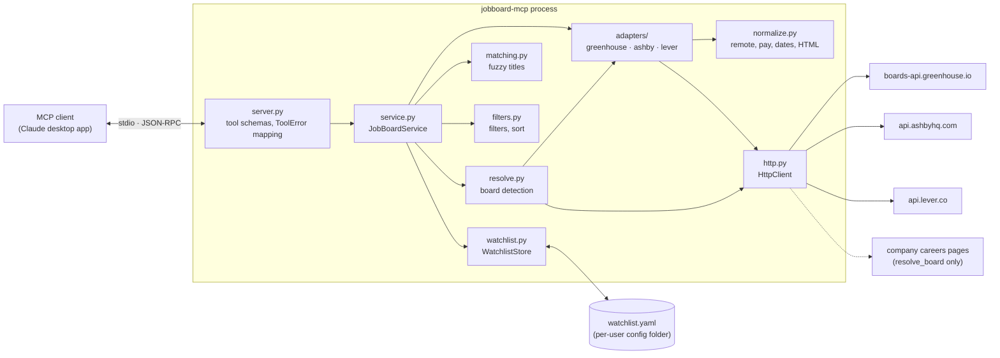
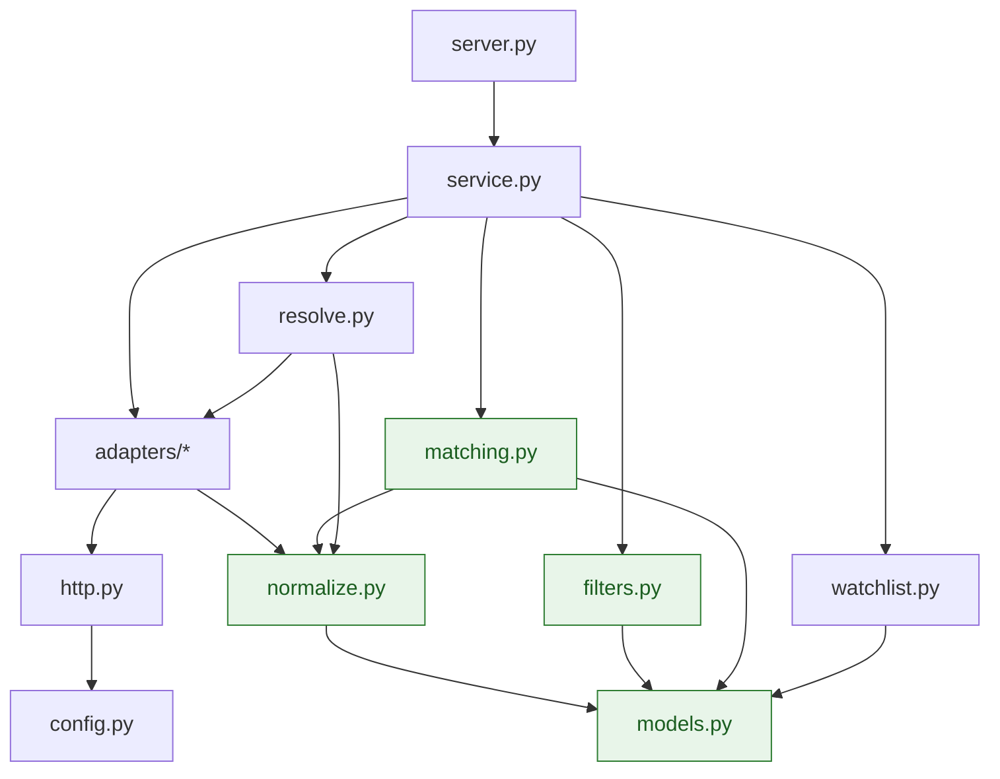
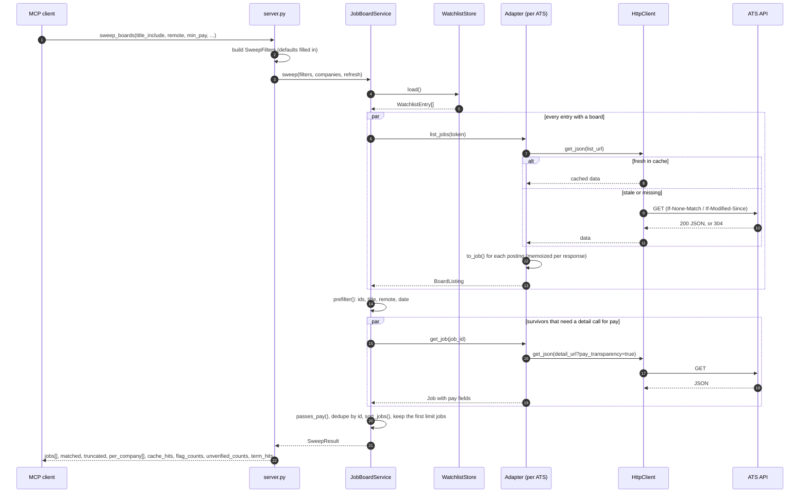
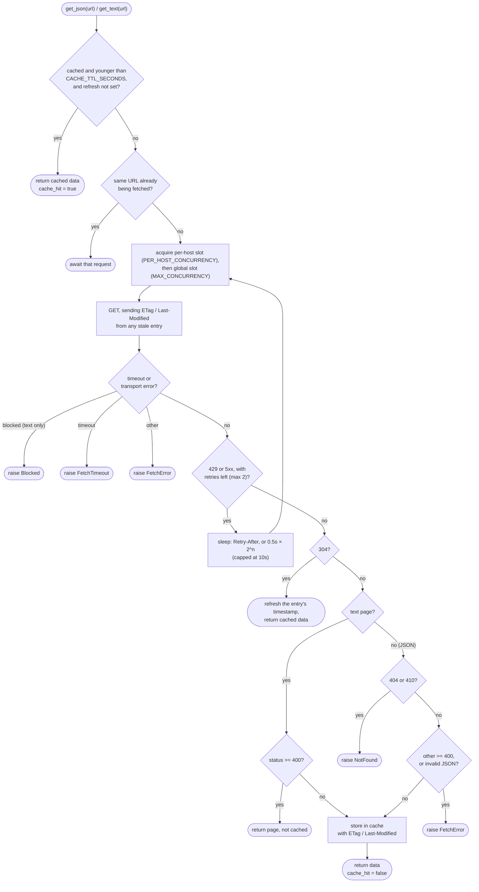
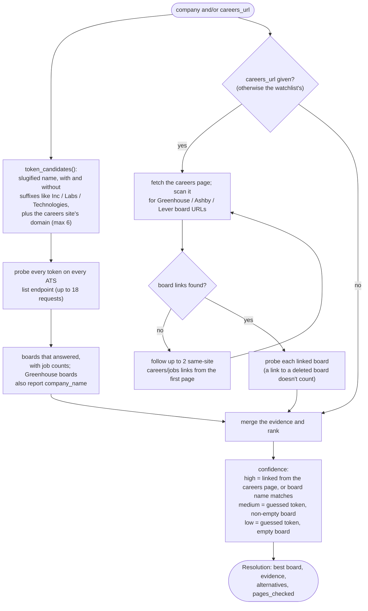
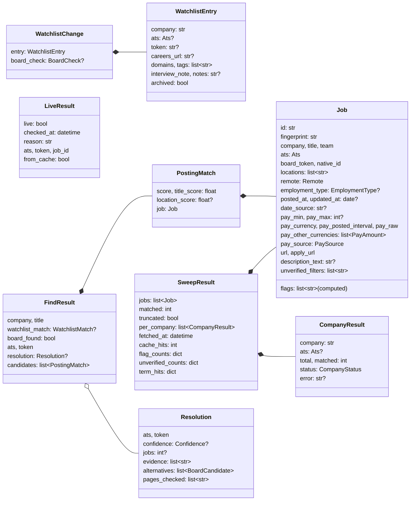
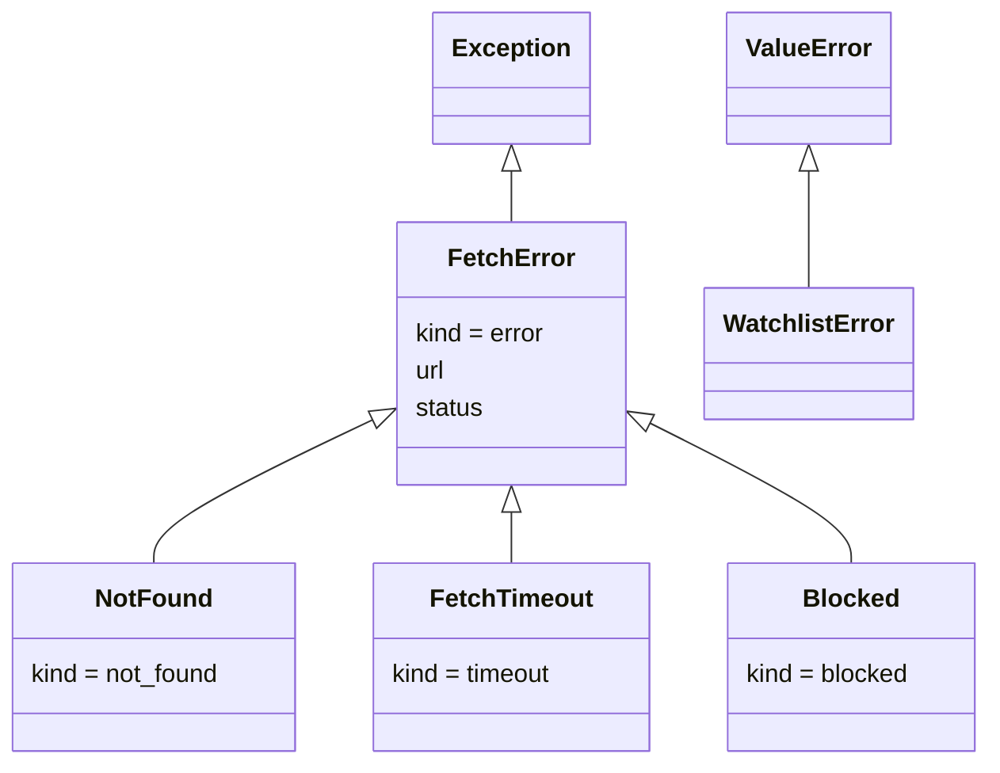

# Architecture

How jobboard-mcp is put together, and what happens on the way from a tool call to a list of
jobs. The diagrams are [Mermaid](https://mermaid.js.org/). They render on GitHub, and in VS Code
with a Mermaid preview extension.

- [Components](#components)
- [Module layers](#module-layers)
- [A sweep, step by step](#a-sweep-step-by-step)
- [The HTTP client](#the-http-client)
- [Board resolution](#board-resolution)
- [Data model](#data-model)
- [Errors](#errors)
- [Design decisions](#design-decisions)

## Components

| Piece | Job |
|-------|-----|
| [server.py](../src/jobboard_mcp/server.py) | Declares each MCP tool, its input schema, and its read-only/write annotations. Builds `SweepFilters` from arguments, turns expected errors into `ToolError`, and removes the write tools when `WATCHLIST_READONLY=true`. Holds no logic of its own. |
| [service.py](../src/jobboard_mcp/service.py) | `JobBoardService`: the logic behind every tool. Kept apart from the MCP wiring so tests can call it directly. |
| [adapters/](../src/jobboard_mcp/adapters/) | One module per ATS. Each turns that ATS's JSON into normalized `Job`s and knows its own URLs. `ADAPTERS` maps `Ats` to an adapter instance. |
| [normalize.py](../src/jobboard_mcp/normalize.py) | Pure functions: HTML to text, date parsing, remote classification, pay parsing, employment type, fingerprints. |
| [filters.py](../src/jobboard_mcp/filters.py) | Pure functions: title terms, the two filter stages, sorting. |
| [matching.py](../src/jobboard_mcp/matching.py) | Pure functions: title normalization and rapidfuzz scoring for `find_company_posting`, and loose company-name lookup. |
| [resolve.py](../src/jobboard_mcp/resolve.py) | Works out which board a company uses, from token probes and careers-page links. |
| [watchlist.py](../src/jobboard_mcp/watchlist.py) | Loads and validates the YAML, and makes comment-preserving, atomic edits. |
| [http.py](../src/jobboard_mcp/http.py) | `HttpClient`: cache, conditional requests, retries, request sharing, and concurrency caps for every outbound request. |
| [urlguard.py](../src/jobboard_mcp/urlguard.py) | Keeps careers-page fetches on the public internet: checks every request and redirect, and pins the connection to the checked address. |
| [config.py](../src/jobboard_mcp/config.py) | `Settings` from environment variables, and JSON logging to stderr. |
| [models.py](../src/jobboard_mcp/models.py) | Pydantic models for jobs, watchlist entries, and every tool result. |

## Module layers

Imports only point downward. The bottom two rows have no I/O, so most tests need no mocking.

Green modules are pure: no network, no files, no clock. (`filters` gets "today" from the caller.)

## A sweep, step by step

`sweep_boards` works in two phases. Phase 1 fetches every board in parallel and runs the cheap
filters. Phase 2 makes extra requests only for the jobs that survive, and only where they can
add something: today, that means Greenhouse jobs whose list entry had no pay, because Greenhouse
publishes pay-transparency ranges only on the detail endpoint.

Notes:

- Each board fetch is wrapped so that **one company's failure never fails the sweep**. Its
  error becomes a `per_company` status (`not_found`, `timeout`, `error`). Entries with no board
  get `no_board` without any request.
- If a pay detail fetch fails, the job is kept with its pay unknown. It isn't dropped.
- `per_company` follows watchlist order (or the order of the `companies` argument), so output
  stays the same from run to run.
- Descriptions are parsed during the sweep, because pay is often only in the text. They are
  removed from the output unless `include_description: true`.
- On a warm sweep, the HTTP cache returns the same response object, so `ListingMemo` reuses the
  jobs it already normalized instead of parsing every board again.

## The HTTP client

Every outbound request goes through `HttpClient`, including the careers-page fetches made by
`resolve_board`.

- The cache lives in memory, keyed by request kind plus URL, and lasts as long as the process.
- The per-host slot is taken before the global one, so a request waiting on a busy host doesn't
  hold up requests to other hosts.
- Requests send a `User-Agent` of `jobboard-mcp/{version} (+repo URL)`.
- Error pages from careers sites are returned instead of raised, because even a 404 page can
  link to the right board.

### Careers pages

Careers URLs come from the watchlist or the MCP client. `ALLOW_CUSTOM_URLS=false` refuses the
client's: the service rejects a `careers_url` passed to `resolve_board`, `add_company`, or
`update_company`, so pages are fetched only from URLs the operator put in the watchlist. Either
way, `get_text` sends them through `GuardedTransport` (in `urlguard.py`) to stop the server
being pointed at internal addresses (SSRF). JSON requests skip it, because their hosts are fixed
in the adapters. For every request, redirects included:

1. The URL must be `http` or `https` on the default port, with no username or password.
2. The host is resolved, and every address it resolves to must be public. Loopback, private,
   link-local (including cloud metadata at `169.254.169.254`), carrier-grade NAT, multicast,
   and IPv4-mapped forms of these are refused.
3. The request connects to the checked address, with the original `Host` header and TLS name
   (`sni_hostname`), so a DNS answer that changes between the check and the connect can't get
   through.

A refused URL raises `Blocked`, which is never retried, and `resolve_board` lists the page in
`pages_checked` with the reason. Because connections are pinned by IP, the careers-page client
keeps no connections alive (another site on the same IP would otherwise reuse one), and it
ignores proxy environment variables (a proxy would do its own DNS lookup and skip the check).

## Board resolution

`resolve_board` (and `find_company_posting`, for companies with no known board) combines two
kinds of evidence. Both run at the same time.

Pages are only searched for board URLs. Nothing else is read from them. If a page links to an
ATS this server doesn't support (Workday, Workable, SmartRecruiters, and others), the evidence
names it, which explains why no board was found.

`resolve_board` never writes. Use `update_company` to save what it finds.

## Data model

`Job.id` is `{ats}:{token}:{native_id}`, and `pay_min` / `pay_max` are annual amounts in
`pay_currency`, never converted.

Enums: `Ats` (greenhouse, ashby, lever), `Remote` (remote_us, remote_global, remote_other,
hybrid, onsite, unknown), `EmploymentType`, `PaySource` (structured, parsed_from_text, none),
`CompanyStatus` (ok, not_found, no_board, error, timeout), `Confidence` (high, medium, low),
`WatchlistMatch` (name, loose_name, board).

## Errors

- A `FetchError`'s `kind` is the `CompanyStatus` value a sweep reports for that company.
  `Blocked` is the exception: only careers-page fetches raise it, and sweeps never make those.
- In single-target tools (`get_posting`, `find_company_posting`, and the rest), `ValueError`,
  `FetchError`, and `WatchlistError` become an MCP `ToolError` with a readable message.
  Anything else is a bug and surfaces as one.
- `is_posting_live` turns a `NotFound` into `live: false`, not an error.

## Design decisions

| Decision | Why |
|----------|-----|
| Public JSON APIs only; careers pages are only scanned for board links | Stays within each site's terms, and the APIs return full boards. A generic web fetch truncates large ones. |
| `remote_us` needs positive evidence | A false "remote US" costs an application; an `unknown` costs one look. See [normalization.md](normalization.md). |
| Missing data is flagged, never dropped | Plenty of good postings omit pay or dates. The caller decides what to do with them. |
| Two-phase sweep | Greenhouse pay is only on the detail endpoint. Fetching details only for survivors keeps a cold sweep to a few dozen requests instead of hundreds. |
| In-memory cache with revalidation | The server is one long-lived process per client, so a 3-hour TTL makes repeat sweeps nearly free, and 304s keep stale ones cheap. |
| Logic in `service.py`, MCP wiring in `server.py` | Tests can call the service directly, and the tool layer stays a thin, readable schema. |
| ruamel.yaml round-trip, atomic replace | The watchlist is also edited by hand, so its comments and layout have to survive tool writes. Every write is re-read and validated before it replaces the file. |
| Logs go to stderr as JSON | stdout carries the MCP stdio transport. |
| Careers-page fetches are checked and pinned to public addresses | The URL comes from the client. Without the guard, a server other people can reach could be made to request internal services or cloud metadata. |
