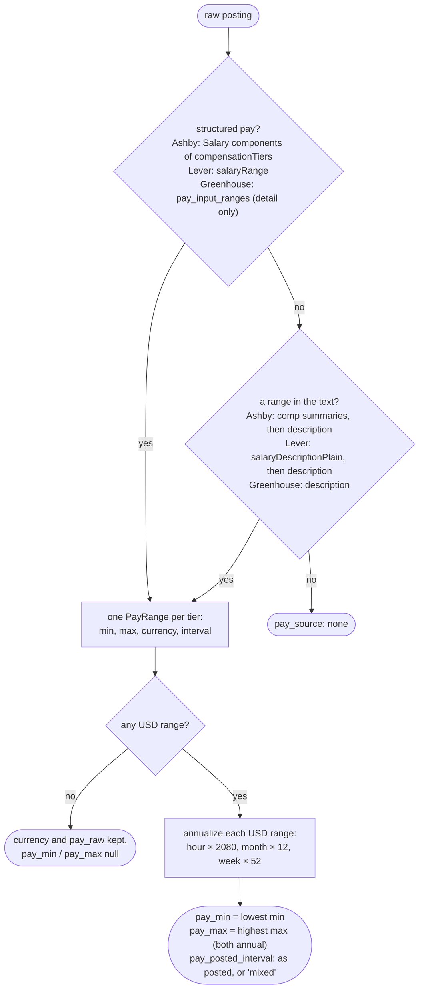
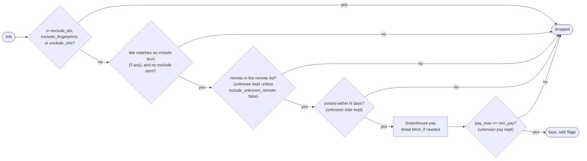

# Normalization rules

Each ATS describes the same posting differently. This page covers how the adapters turn that
into one `Job` shape, and how the sweep filters use it. The code lives in
[normalize.py](../src/jobboard_mcp/normalize.py) and [filters.py](../src/jobboard_mcp/filters.py).
Every rule below has tests in [test_normalize.py](../tests/test_normalize.py) and
[test_filters.py](../tests/test_filters.py), most of them built from strings found in real
postings.

For where each ATS keeps the raw fields, see [api-notes.md](api-notes.md).

## Principles

1. **Never guess in the job seeker's favor.** A posting is `remote_us` only with positive
   evidence. Pay is reported in USD only when it was posted in USD.
2. **Keep the raw value.** `pay_raw`, `date_source`, and `locations` show what the normalized
   fields came from, so any result can be checked.
3. **Missing data is flagged, not dropped.** If a filter can't be checked because the data is
   missing, the job stays in the results with a flag saying so.

## Remote status

`classify_remote(locations, workplace_type, countries)` returns one of:

| Value | Meaning |
|-------|---------|
| `remote_us` | Remote, and a US-based worker is eligible |
| `remote_global` | Remote from anywhere ("Anywhere", "Worldwide", "Global") |
| `remote_other` | Remote, but only in named non-US places ("Remote, Canada", "EMEA") |
| `hybrid` | Hybrid |
| `onsite` | On-site |
| `unknown` | Not enough evidence either way |

Details:

- Locations are split on `;` and `|` first. Greenhouse packs several into one string
  ("Remote, Canada; Remote, United States"), and Ashby countries can read "US | EU".
- **Any US segment wins.** "Remote - US or Canada" is open to US workers, so it's `remote_us`.
- Spelled-out US markers are checked before non-US places. Two-letter state codes are checked
  after them, so "Bangalore, IN" isn't read as Indiana. `CA` is never read as California,
  because it's also Canada's country code. "California" spelled out does count.
- **A bare "Remote" is `unknown`.** Many boards mean "remote in our home country", and that
  country often isn't the US.
- **Country- or region-only locations aren't on-site.** On a remote-first board, a location of
  "United States" or "EMEA" usually means remote. With no remote word, US ones ("United States",
  "AMER", "Texas") come out `unknown`, not `onsite`, because there's no positive evidence of
  remote work.
- **Non-US country- or region-only locations are `remote_other`.** "Portugal", "ANZ Region",
  "United Kingdom, Ireland or Poland", or a list of EU countries names no office, and whatever the
  arrangement, a US-based worker isn't eligible. Labeling them `unknown` would keep them in
  US-remote sweeps. A mix that includes the US ("United States; Portugal") stays `unknown`.
- **Bracketed title hints count as location text.** "Engineer (US Remote)" or "QA Engineer
  (remote)" supply the remote word when the ATS gives none. ClickHouse's Ashby board leaves
  `workplaceType` empty on many jobs and says "remote" only in the title. Unbracketed words don't
  count, so "Remote Sensing Engineer" isn't a remote job. A structured `workplaceType` still wins.
- Lever's `workplaceType: "unspecified"` counts as having no structured signal, but it doesn't
  allow the "city means on-site" rule, which only applies when the ATS has no such field.
- Ashby's `isRemote` is used only when `workplaceType` is missing. Ashby marks some hybrid roles
  `isRemote: true`.

## Pay

Rules:

- `pay_min` and `pay_max` are **annual USD or null**. Nothing is converted between currencies.
- `pay_posted_interval` is how the pay was posted (`year`, `hour`, `month`, `week`, or `mixed`
  across tiers). An hourly posting has `pay_posted_interval: "hour"` and annualized numbers:
  $56.07/hour gives `pay_min: 116626`.
- Multi-tier pay (by region or level) reports the overall range, with every tier in `pay_raw`.
- Only base salary counts. Ashby `Bonus`, `Commission`, and `EquityCashValue` components are
  skipped.
- Greenhouse `pay_input_ranges` are in cents and have no interval field. A maximum under $1,000
  is read as hourly.
- `pay_source` says where the numbers came from: `structured`, `parsed_from_text`, or `none`.

### Parsing pay from text

`parse_pay_text` only starts matching at a currency symbol (`$ £ € ₹`), which keeps long
descriptions cheap to scan. It recognizes:

| Text | Result |
|------|--------|
| `$150,000 - $180,000` | 150000 to 180000 USD, year |
| `$150K–$180K USD` | same |
| `$126,400—$213,600 USD` | en and em dashes, or `to` |
| `$75/hr`, `$60 - $80 per hour` | hourly, annualized × 2080 |
| `CA$120,000 - CA$140,000`, `C$...` | CAD (no USD numbers) |
| `£60,000 - £80,000` | GBP (no USD numbers) |
| `€68.000–€91.000` | EUR, year. A dot before exactly three digits is a thousands separator, but `$56.07` is still cents |

Matches are thrown out when they don't look like pay: a figure followed by "million" or "bn", or
a range outside salary sizes (an annual range has to fall between $10,000 and $2,000,000), so a
"$500 stipend" or "$2B in funding" isn't read as pay.

## Dates

- `posted_at` comes from the best "first published" field: Greenhouse `first_published`
  (falling back to `updated_at`), Ashby `publishedAt`, or Lever `createdAt`. `date_source`
  names the field used.
- ISO-8601 strings and epoch timestamps (seconds or milliseconds) are converted to a UTC
  calendar date.
- Lever's `createdAt` can come before the job was published, so Lever jobs can look a little
  older than they are.

## Employment type

The free-text value is matched loosely, in this order: intern, part-time, contract (also
temporary, freelance, fixed-term), then full-time (also permanent, regular). It's `null` when
the ATS gives nothing and `unknown` when it gives something unrecognizable, such as Lever's
`commitment: "Remote"`.

The title can also mark a contract role. When it does, `contract` replaces a missing, `unknown`,
or `full_time` value (intern and part-time are kept). It counts when the word is in brackets
("Senior Software Engineer, Android (Contract)"), at the end after a dash or comma ("Data
Engineer - Contractor"), or at the start ("Contract Software Engineer"). A leading "Contract"
followed by a role like Manager, Specialist, or Analyst is a job that handles contracts, so it
doesn't count.

## Descriptions

HTML is unescaped (Greenhouse escapes it twice), `<script>` and `<style>` are removed, block
tags and ` ` become line breaks, `<li>` becomes `- `, the remaining tags are stripped, and
whitespace is collapsed. Lever descriptions combine `descriptionPlain`, each `lists` section,
and `additionalPlain`.

## Identity

- `id` is `{ats}:{token}:{native_id}`. It's unique and stable, and the input format for
  `exclude_ids`.
- `fingerprint` is the first 16 hex characters of a SHA-1 of the normalized company, title, and
  sorted locations (lowercased, punctuation removed, "Sr." → "senior"). It identifies the same
  role across boards and sources, for `exclude_fingerprints`.

## Sweep filters

### Title terms

- Plain terms match **whole words**, ignore case, and allow a plural: `engineer` matches
  "Engineers" but not "Engineering", and `intern` matches "Interns" but not "Internal Tools".
  Multi-word terms allow any whitespace between the words.
- Prefix a term with `re:` to use a regular expression: `re:\bsr\.?\b`.
- The default `title_exclude` is `intern`, `internship`, `new grad`, `principal`. Pass `[]` to
  exclude nothing.

### Flags

Each job has a `flags` list naming data that's missing:

| Flag | When |
|------|------|
| `remote_unknown` | the job's remote status is `unknown`. Set when the job is built, so `get_posting` and `sweep_boards` agree |
| `pay_unknown` | a sweep set `min_pay` and the job has no USD maximum |
| `date_unknown` | a sweep set `posted_within_days` and the job has no date |

`flag_counts` in the sweep result totals them.

### Sorting

Newest `posted_at` first, unknown dates last, then by company, title, and id. The same input
always gives the same order.
