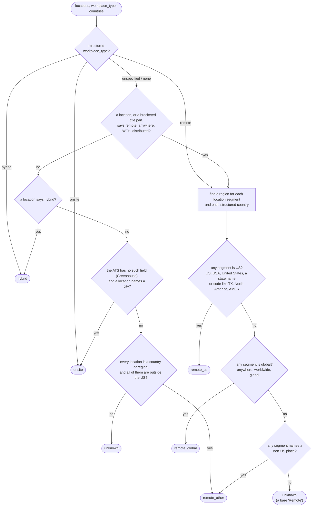
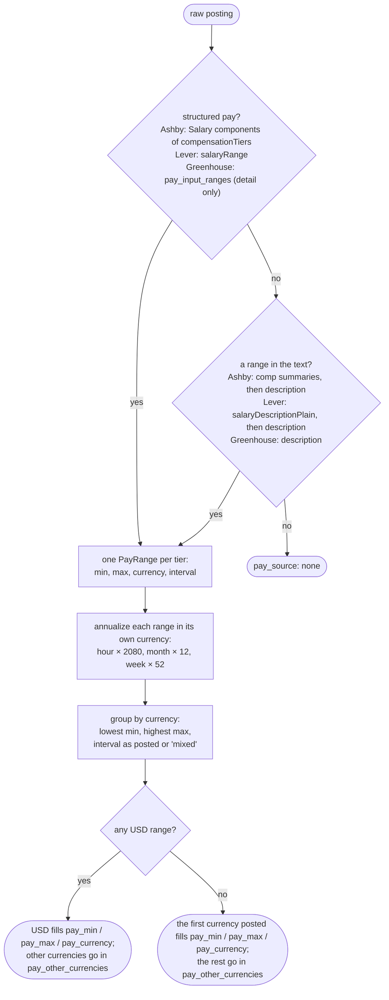
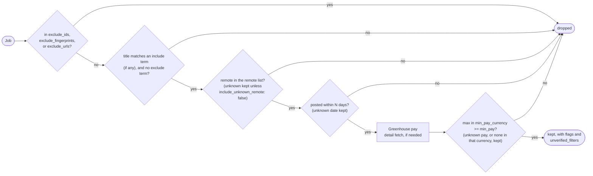

# Normalization rules

Each ATS describes the same posting differently. This page covers how the adapters turn that
into one `Job` shape, and how the sweep filters use it. The code lives in
[normalize.py](../src/jobboard_mcp/normalize.py) and [filters.py](../src/jobboard_mcp/filters.py).
Every rule below has tests in [test_normalize.py](../tests/test_normalize.py) and
[test_filters.py](../tests/test_filters.py), most of them built from strings found in real
postings.

For where each ATS keeps the raw fields, see [api-notes.md](api-notes.md).

## Principles

1. **Never guess in the job seeker's favor.** A posting is `remote_us` only with positive
   evidence. Pay is reported in the currency it was posted in, never converted.
2. **Keep the raw value.** `pay_raw`, `date_source`, and `locations` show what the normalized
   fields came from, so any result can be checked.
3. **Missing data is flagged, not dropped.** Every job says what's missing in its `flags`. If
   a filter can't be checked because the data is missing, the job stays in the results and
   names that filter in `unverified_filters`.

## Remote status

`classify_remote(locations, workplace_type, countries)` returns one of:

| Value | Meaning |
|-------|---------|
| `remote_us` | Remote, and a US-based worker is eligible |
| `remote_global` | Remote from anywhere ("Anywhere", "Worldwide", "Global") |
| `remote_other` | Remote, but only in named non-US places ("Remote, Canada", "EMEA") |
| `hybrid` | Hybrid |
| `onsite` | On-site |
| `unknown` | Not enough evidence either way |

Details:

- Locations are split on `;` and `|` first. Greenhouse packs several into one string
  ("Remote, Canada; Remote, United States"), and Ashby countries can read "US | EU".
- **Any US segment wins.** "Remote - US or Canada" is open to US workers, so it's `remote_us`.
- Spelled-out US markers are checked before non-US places. Two-letter state codes are checked
  after them, so "Bangalore, IN" isn't read as Indiana. `CA` is never read as California,
  because it's also Canada's country code. "California" spelled out does count.
- **A bare "Remote" is `unknown`.** Many boards mean "remote in our home country", and that
  country often isn't the US.
- **Country- or region-only locations aren't on-site.** On a remote-first board, a location of
  "United States" or "EMEA" usually means remote. With no remote word, US ones ("United States",
  "AMER", "Texas") come out `unknown`, not `onsite`, because there's no positive evidence of
  remote work.
- **Non-US country- or region-only locations are `remote_other`.** "Portugal", "ANZ Region",
  "United Kingdom, Ireland or Poland", or a list of EU countries names no office, and whatever the
  arrangement, a US-based worker isn't eligible. Labeling them `unknown` would keep them in
  US-remote sweeps. A mix that includes the US ("United States; Portugal") stays `unknown`.
- **Bracketed title hints count as location text.** "Engineer (US Remote)" or "QA Engineer
  (remote)" supply the remote word when the ATS gives none. ClickHouse's Ashby board leaves
  `workplaceType` empty on many jobs and says "remote" only in the title. Unbracketed words don't
  count, so "Remote Sensing Engineer" isn't a remote job. A structured `workplaceType` still wins.
- Lever's `workplaceType: "unspecified"` counts as having no structured signal, but it doesn't
  allow the "city means on-site" rule, which only applies when the ATS has no such field.
- Ashby's `isRemote` is used only when `workplaceType` is missing. Ashby marks some hybrid roles
  `isRemote: true`.
- Workday's `remoteType` and Oracle's `WorkplaceType` are free text set by each employer. A label mentioning remote, virtual,
  telecommuting, or work from home counts as `remote`; one mentioning hybrid as `hybrid`; on-site
  or in-office as `onsite`. Anything else ("Multi-site", "Location Independent-Commutable"), and
  a missing field, counts as `unspecified`, so a city alone never makes a Workday job on-site:
  employers that don't use the field can't be told apart from jobs that left it blank. Workday
  list rows carry no `remoteType`, so a swept Workday job's status comes from its detail call.
  Oracle's search rows do carry the field.

## Pay

Rules:

- `pay_min` and `pay_max` are **annual amounts in `pay_currency`, or null**. Nothing is
  converted between currencies. When a posting lists pay in several currencies (US and Canada
  tiers, say), USD is the primary currency if it's offered, otherwise the first one posted, and
  each other currency gets its own annual range in `pay_other_currencies`.
- Annualizing uses the US convention of 2080 hours a year for every currency. Hourly pay in
  other countries may assume fewer hours, so treat annualized non-US hourly figures as rough.
- `pay_posted_interval` is how the pay was posted (`year`, `hour`, `month`, `week`, or `mixed`
  across tiers). An hourly posting has `pay_posted_interval: "hour"` and annualized numbers:
  $56.07/hour gives `pay_min: 116626`.
- Multi-tier pay (by region or level) reports the overall range, with every tier in `pay_raw`.
- Only base salary counts. Ashby `Bonus`, `Commission`, and `EquityCashValue` components are
  skipped.
- Greenhouse `pay_input_ranges` are in cents and have no interval field. A maximum under $1,000
  is read as hourly.
- `pay_source` says where the numbers came from: `structured`, `parsed_from_text`, or `none`.
- For Greenhouse, a sweep and `get_posting` can report the same pay with a different
  `pay_source` and `pay_raw`. The list endpoint has no structured pay, so a sweep parses the
  description (`parsed_from_text`) and fetches the detail endpoint only for jobs where that finds
  nothing. `get_posting` always reads the detail endpoint's `pay_input_ranges` (`structured`).
  On live boards (2026-10-16), all 225 Greenhouse jobs with pay in the description had the same
  `pay_min`, `pay_max`, currency, and interval both ways, so fetching every detail page in a sweep
  wouldn't change the numbers, only add a request per job.

### Parsing pay from text

`parse_pay_text` only starts matching at a currency symbol (`$ £ € ₹`), which keeps long
descriptions cheap to scan. It recognizes:

| Text | Result |
|------|--------|
| `$150,000 - $180,000` | 150000 to 180000 USD, year |
| `$150K–$180K USD` | same |
| `$126,400—$213,600 USD` | en and em dashes, or `to` |
| `$75/hr`, `$60 - $80 per hour` | hourly, annualized × 2080 |
| `CA$120,000 - CA$140,000`, `C$...` | 120000 to 140000 CAD, year |
| `£60,000 - £80,000` | 60000 to 80000 GBP, year |
| `€68.000–€91.000` | EUR, year. A dot before exactly three digits is a thousands separator, but `$56.07` is still cents |

Matches are thrown out when they don't look like pay: a figure followed by "million" or "bn", or
a range outside salary sizes (an annual range has to fall between $10,000 and $2,000,000), so a
"$500 stipend" or "$2B in funding" isn't read as pay. The same bounds apply in every currency,
so annual pay in currencies with large figures (INR, JPY) is rejected when it's written in
the text, and the job is flagged `pay_unknown`. Structured pay isn't bounded this way.

## Dates

- `posted_at` comes from the best "first published" field: Greenhouse `first_published`
  (falling back to `updated_at`), Ashby `publishedAt`, or Lever `createdAt`. `date_source`
  names the field used.
- ISO-8601 strings and epoch timestamps (seconds or milliseconds) are converted to a UTC
  calendar date.
- Lever's `createdAt` can come before the job was published, so Lever jobs can look a little
  older than they are.
- Workday list rows say only "Posted 3 Days Ago". With the sweep's date, that becomes a date
  (`date_source: "postedOn"`); "Posted 30+ Days Ago" stays unknown. The detail call then gives
  the exact `startDate` (`date_source: "startDate"`), which replaces it.
- Oracle rows give `PostedDate`, and its detail `ExternalPostedStartDate`.

## Employment type

The free-text value is matched loosely, in this order: intern, part-time, contract (also
temporary, freelance, fixed-term), then full-time (also permanent, regular). It's `null` when
the ATS gives nothing and `unknown` when it gives something unrecognizable, such as Lever's
`commitment: "Remote"`.

The title can also mark a contract role. When it does, `contract` replaces a missing, `unknown`,
or `full_time` value (intern and part-time are kept). It counts when the word is in brackets
("Senior Software Engineer, Android (Contract)"), at the end after a dash or comma ("Data
Engineer - Contractor"), or at the start ("Contract Software Engineer"). A leading "Contract"
followed by a role like Manager, Specialist, or Analyst is a job that handles contracts, so it
doesn't count.

## Descriptions

HTML is unescaped (Greenhouse escapes it twice), `<script>` and `<style>` are removed, block
tags and ` ` become line breaks, `<li>` becomes `- `, the remaining tags are stripped, and
whitespace is collapsed. Lever descriptions combine `descriptionPlain`, each `lists` section,
and `additionalPlain`.

## Links

`url` and `apply_url` are upgraded from `http://` to `https://`. CircleCI's Greenhouse board,
for one, links to `http://www.circleci.com/careers/...`.

## Identity

- `id` is `{ats}:{token}:{native_id}`. It's unique and stable, and the input format for
  `exclude_ids`.
- `fingerprint` is the first 16 hex characters of a SHA-1 of the normalized company, title, and
  sorted locations (lowercased, punctuation removed, "Sr." → "senior"). It identifies the same
  role across boards and sources, for `exclude_fingerprints`.
- Because locations are part of the fingerprint, one role posted twice with different locations
  ("Remote" and "Remote US") gets two fingerprints. That's on purpose: companies often post one
  requisition per location, and merging them would hide real differences.

## Sweep filters

### Title terms

- Plain terms match **whole words**, ignore case, and allow a plural: `engineer` matches
  "Engineers" but not "Engineering", and `intern` matches "Interns" but not "Internal Tools".
  In multi-word terms, spaces and hyphens are interchangeable, in the term and in the title:
  `full stack` and `full-stack` both match "Full Stack" and "Full-Stack". A word written with
  no separator ("Fullstack") is a different word, so pass it too.
- Terms are matched as plain text, never as regular expressions. A client-supplied regex can
  backtrack for seconds on a short title and stall the whole server.
- A term written as a regex is refused, not matched literally, because it would silently match
  nothing. That's any term starting with `re:` or using `| * ? ( ) [ ] { } ^ $ \`. The call
  fails before any board is fetched, with a message naming the term. Write each alternative as
  its own phrase: `product owner`, `product manager` instead of `re:product (owner|manager)`.
  `+ # . / &` are allowed, so `c++`, `c#`, `.net`, and `ui/ux` work.
- `sweep_boards` returns `term_hits`: for each term, how many titles on the swept boards it
  matches, counted before any filter. A 0 means the term matches nothing there, which is
  usually a misspelling or a phrase the boards don't use.
- Neither list has a default. With no terms, no title is filtered out.

#### Useful terms

Starting points for `title_include` and `title_exclude`. Every term here is checked against the
example titles in `test_useful_terms` in [tests/test_filters.py](../tests/test_filters.py).
Keep the two in step.

| Goal | Terms | Watch out for |
|------|-------|---------------|
| Early-career roles | `intern`, `internship`, `new grad`, `graduate`, `entry level`, `junior`, `jr`, `apprentice`, `co-op` | `intern` doesn't match "Internship", so list both. |
| Senior and above | `senior`, `sr`, `staff`, `principal`, `distinguished`, `lead` | `lead` also matches "Lead Generation Specialist". |
| Leadership | `manager`, `director`, `head of`, `vp`, `vice president`, `chief` | `manager` also matches "Product Manager"; `chief` matches "Chief of Staff". |
| Software engineering | `engineer`, `engineering`, `developer`, `programmer`, `swe` | `engineer` doesn't match "Engineering Manager"; add `engineering` if you want those. |
| Web | `frontend`, `front end`, `backend`, `back end`, `full stack`, `fullstack` | Titles spell these three ways. `front end` covers "Front End" and "Front-End"; `frontend` covers "Frontend". |
| Infrastructure | `sre`, `site reliability`, `devops`, `platform`, `infrastructure` | |
| Data and ML | `data engineer`, `data scientist`, `machine learning`, `ml`, `ai` | |
| Product and design | `product manager`, `designer`, `ux` | |

Some companies mark level with numerals ("Engineer III"). `ii` and `iii` work as terms, but
levels mean different things at different companies. Use the `remote` filter for location,
not title terms: "(Remote, US)" in a title is already read as remote evidence.

### Flags

Each job has a `flags` list naming data that's missing. Flags describe the job, not the
search: they don't depend on which filters were used, so `get_posting`, `find_company_posting`,
and `sweep_boards` show the same flags for the same job.

| Flag | When |
|------|------|
| `pay_unknown` | no pay was posted: `pay_min` and `pay_max` are both null |
| `date_unknown` | `posted_at` is null |
| `remote_unknown` | `remote` is `unknown` |

A minimum with no maximum ("$120,000+") is known pay and isn't flagged. Pay in a currency
other than USD is known pay too.

`flags` is a computed field on `Job`, worked out from the job's other fields whenever it's read.
That keeps it right after a sweep fills in Greenhouse pay from the detail endpoint.

`flag_counts` in the sweep result totals them.

### Unverified filters

Flags say what a job is missing. `unverified_filters` says what that meant for this search:
the `sweep_boards` filters the job was kept under without being checked against. A job with
an empty list verifiably meets every filter that was set.

| Filter | Listed when |
|--------|-------------|
| `remote` | `remote` was set and the job's status is `unknown` (kept because `include_unknown_remote` is on) |
| `min_pay` | `min_pay` was set and the job has no maximum in `min_pay_currency`: no pay posted, only a minimum, or pay only in other currencies |
| `posted_within_days` | `posted_within_days` was set and `posted_at` is null |

A filter that wasn't set is never listed, so an unfiltered sweep has empty lists. A job listing
`min_pay` but not flagged `pay_unknown` has pay in another currency: `pay_currency` and
`pay_other_currencies` say which. `unverified_counts` in the sweep result totals them.
The list is empty outside `sweep_boards`, which is the only tool that filters.

### Sorting

Newest `posted_at` first, unknown dates last, then by company, title, and id. The same input
always gives the same order.
