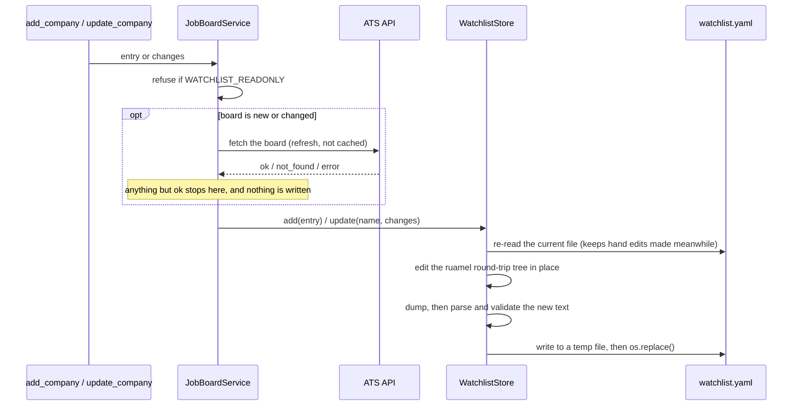

# The watchlist

The watchlist lists the companies the server sweeps. It's the only file the server ever
writes, and you can also edit it by hand.

It lives in your per-user config folder, not next to the code:

| Platform | Default path |
|----------|--------------|
| Windows | `%APPDATA%\jobboard-mcp\watchlist.yaml` |
| macOS, Linux | `~/.config/jobboard-mcp/watchlist.yaml`, or `$XDG_CONFIG_HOME/jobboard-mcp/watchlist.yaml` when that's set |

`list_watchlist` returns the path in use, so you can also ask your MCP client where it is. On
first run the server copies [watchlist.example.yaml](../src/jobboard_mcp/watchlist.example.yaml)
there to give you something to start from. Set `WATCHLIST_PATH` to keep your list somewhere
else. A custom path isn't seeded: the server reports it as missing instead, in case it's a typo.

## Format

A YAML list with one mapping per company:

```yaml
- company: Temporal Technologies   # display name, unique (case-insensitive)
  ats: ashby                       # greenhouse | ashby | lever | null
  token: temporal                  # board token, or null
  careers_url: https://temporal.io/careers
  domains: [dev tools, open source]
  tags: []                         # e.g. [hww] = hiring-without-whiteboards
  interview_note: null
  notes: Old Greenhouse board is gone
  archived: true                   # optional; only written when true
```

| Field | Required | |
|-------|----------|---|
| `company` | yes | Shown on every job. Must be unique. |
| `ats`, `token` | both or neither | Without them, sweeps skip the entry with status `no_board`. |
| `careers_url` | no | `resolve_board` uses it when no URL is passed. |
| `domains`, `tags` | no | Free-form. Used by `list_watchlist` filters. |
| `interview_note`, `notes` | no | Free-form. |
| `archived` | no | `true` keeps the entry but stops sweeping it. See [Archiving](#archiving). |

The file is validated every time it's read: it must be a list, every entry must match the
schema, names must be unique, and `ats`/`token` must be set together. An invalid file makes
watchlist-based tools fail with a message naming the problem. They don't fall back to a partial
list.

## Archiving

There's no delete tool. To stop sweeping a company, archive it:

```text
update_company(company="Replit", archived=true)
```

- Sweeps skip archived companies, unless you name one in `companies`.
- `list_watchlist` hides them and reports how many in `archived_hidden`. Pass
  `include_archived: true` to see them.
- `get_posting`, `find_company_posting`, and `is_posting_live` still use their boards, so you can
  check on a role you applied to.
- `add_company` with an archived name fails and points you to `update_company`.
- `archived=false` restores the entry. The `archived: true` line is removed rather than set to
  false, so restoring leaves the entry exactly as it was.

The notes, tags, and interview notes stay in place. To remove an entry for good, delete it from
the file by hand.

## Finding a board token

For Greenhouse, Ashby, Lever, Workable, and Rippling, the token is the path segment after the ATS
host. A Personio token is the subdomain (`vivid` in `vivid.jobs.personio.de`). A Workday
token is `{tenant}.{wdN}/{site}`, and an Oracle Recruiting Cloud token
`{pod}.fa.{region}/{site}`, both from the careers site's address. Case doesn't matter, except
for Rippling, whose slugs are case-sensitive (they're lowercase in practice):

| ATS | Board URL | Token |
|-----|-----------|-------|
| Greenhouse | `job-boards.greenhouse.io/gitlab` | `gitlab` |
| Ashby | `jobs.ashbyhq.com/linear` | `linear` |
| Lever | `jobs.lever.co/outreach` | `outreach` |
| Workable | `apply.workable.com/huggingface` | `huggingface` |
| Rippling | `ats.rippling.com/rippling/jobs` | `rippling` |
| Personio | `vivid.jobs.personio.de` | `vivid` |
| Workday | `homedepot.wd5.myworkdayjobs.com/CareerDepot` | `homedepot.wd5/careerdepot` |
| Oracle | `ehxr.fa.us2.oraclecloud.com/hcmUI/CandidateExperience/en/sites/CX_1` | `ehxr.fa.us2/cx_1` |

Or ask the server to find it, then save the result:

```text
resolve_board(company="Posit", careers_url="https://posit.co/careers/")
  -> greenhouse / rstudio, confidence high
update_company(company="Posit", ats="greenhouse", token="rstudio")
```

`resolve_board` doesn't guess Workday or Oracle tokens (each has several parts), and some
employers' careers pages refuse non-browser requests. If it can't find the board, open any of
the company's job links and take the token from its address.

## How edits work



- Comments, blank lines, quoting, and field order are kept. A field added by `update_company`
  goes in its usual position, and the blank line between entries stays in place.
- `add_company` appends to the end of the file.
- The new text is parsed and validated before it replaces the file, so a write can't leave the
  file unreadable. The swap is atomic, so a crash can't leave it half-written either.
- The file is re-read on every call, so hand edits take effect without a restart.

## Read-only mode

Set `WATCHLIST_READONLY=true` for any deployment other people can reach. `add_company` and
`update_company` then aren't registered at all, and `list_watchlist` reports
`readonly: true`.

Set `ALLOW_CUSTOM_URLS=false` too, so `resolve_board` won't fetch a careers URL the client
passes. The watchlist's own `careers_url` values are still used.
